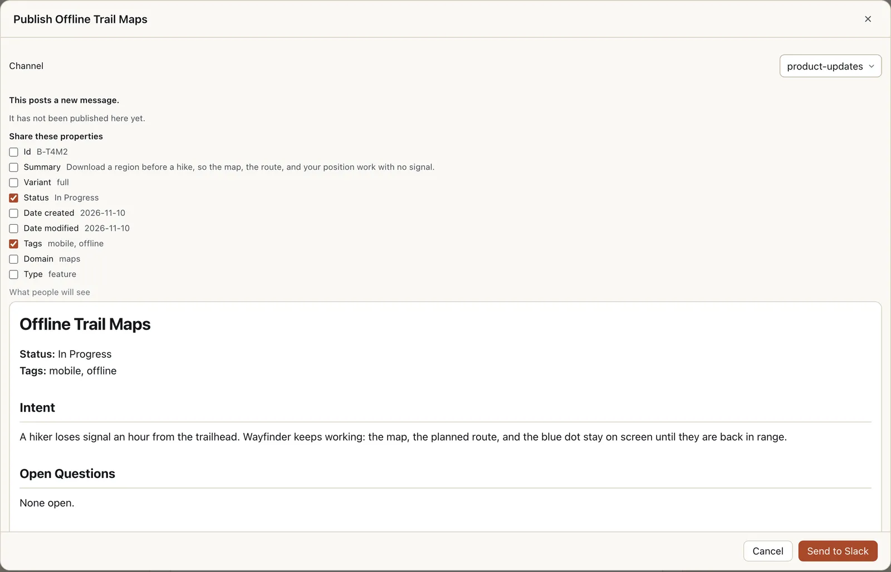
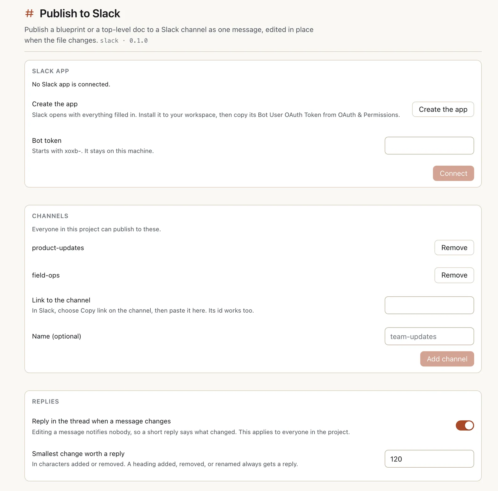
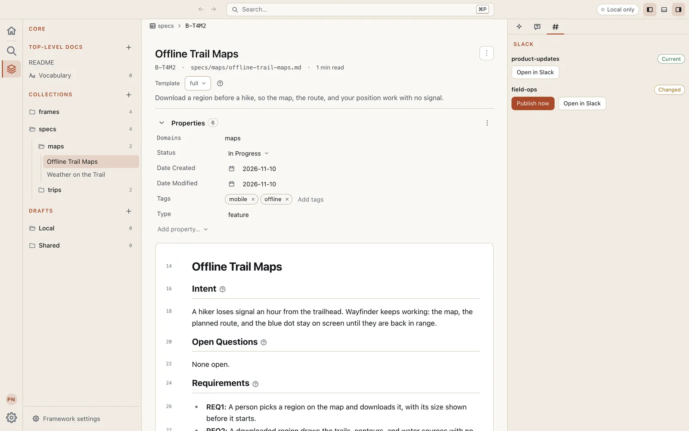
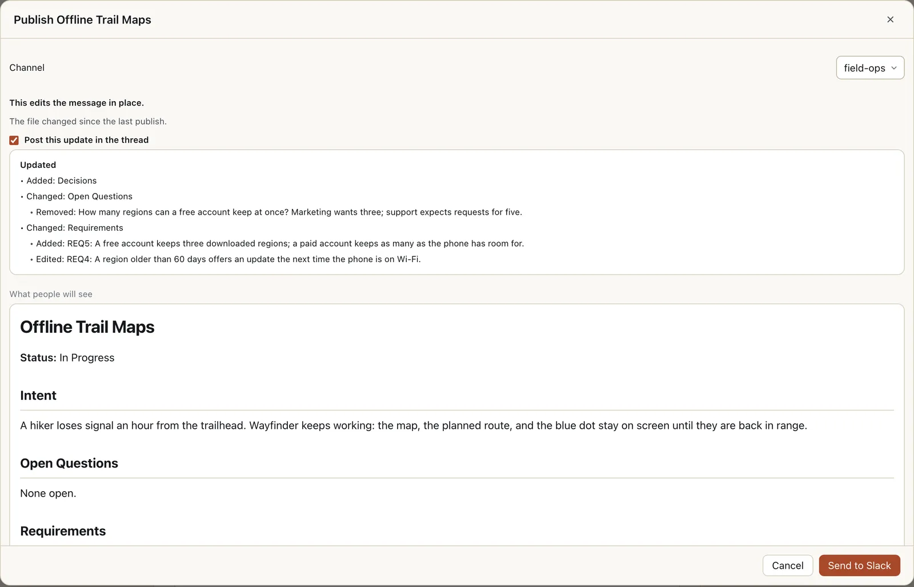

# Publish to Slack

Send a blueprint or a top-level doc from [Eidos MD](https://eidosmd.com) to a Slack channel as one message, and keep that message current. When the file changes, the next publish edits the message in place and replies in its thread with what changed. The channel holds one up-to-date message per file, not a scroll of stale copies.



Before anything leaves your machine you see exactly what goes out: the channel, which properties come along, and a preview of the message.

- **One message per file.** The first publish posts it. Every publish after that edits the same message, so a link to it never goes stale.
- **Changes people actually notice.** Editing a message notifies nobody, so a big enough change gets a short reply in the thread listing the sections and list items added, removed, and changed.
- **Two permissions, nothing more.** It posts through a Slack app your workspace makes for itself, which can only write messages.
- **Private by design.** It runs on your machine and talks to Slack directly. Nothing is hosted, and nothing is sent unless you ask.

## Get started

### 1. Install it

In Eidos MD, open **Settings > Community plugins > Browse**, search for Slack, and open **Publish to Slack**. Choose **Install**, then **Enable**. That installs it from the Registry, which checks every file against the checksum it lists, so install it there rather than from this repository.

### 2. Create your Slack app

Open the plugin's settings: **Settings > Community plugins**, then **Publish to Slack**. Under **Slack app**, choose **Create the app**. Slack opens with the app, Eidos Publish, already filled in. It asks for two permissions only: `chat:write` to post, edit, and reply, and `chat:write.public` to post in a public channel without being invited. Create it in your workspace and install it there. If your workspace asks for apps to be approved, a workspace admin approves the install first.

### 3. Connect it

On the app's **OAuth & Permissions** page in Slack, copy its **Bot User OAuth Token**, which starts with `xoxb-`. Back in Eidos MD, paste it into **Bot token** and choose **Connect**. The token is checked with Slack before it is kept, and it stays on this machine. The card then reads **Connected to** and your workspace's name.



Channels are shared with the project, so here a teammate has already added two: this person only creates the app and pastes its token. **Replies** at the bottom also applies to everyone in the project.

### 4. Add a channel

In Slack, choose **Copy link** on the channel. Back in Eidos MD, paste it into **Link to the channel**, give it a **Name (optional)** if you like, and choose **Add channel**. The channel's id works in place of the link. A public channel is ready at once; for a private channel, invite the app first with `/invite` in that channel.

## Everyday use

### Publish a file

Open a blueprint or a top-level doc and look at the **Slack** tab in the right sidebar. It lists each channel with where this file stands there: **Not published**, **Current**, or **Changed**. **Publish now** opens the Publish dialog for that channel, and **Open in Slack** takes you to the message. **Publish…** in the command palette opens the same dialog.



In the dialog:

- **Channel** says where it goes.
- **Share these properties**, on a first post: tick the frontmatter worth showing at the top of the message, such as Status or Tags. The channel remembers your choice, and a shared property stays on the message's later edits.
- **What people will see** previews the message.

Choose **Send to Slack** to post it.

### When the file changes

The channel's row turns **Changed**. Publish again and the dialog says **This edits the message in place.** When the change is big enough, **Post this update in the thread** is ticked and shows the reply that goes with it. A smaller change leaves it unticked, and you can tick it when people should hear about it anyway. When nothing changed, the dialog says **Nothing to send.**



What counts as big enough is set under **Replies** in the plugin's settings: **Smallest change worth a reply**, 120 characters added or removed by default, and a heading added, removed, or renamed always counts. **Reply in the thread when a message changes** turns replies off for the whole project.

### Automations

The **Publish to Slack** step publishes the file that started a run, or one you name, to a channel, with the properties that channel last shared. The first run to reach it asks before it sends, since it leaves your machine.

## Good to know

- **Messages are posted as the app, not as you.** Slack lets an app edit only the messages it posted, so a message stays editable for everyone who publishes through the same app.
- **A private channel needs the app invited** with `/invite`. Until it is, publishing there fails and posts nothing.
- **A message can be up to 12,000 characters.** A longer one is refused before anything is sent.
- **The file is the source.** An edit made in Slack is overwritten by the next publish. A message deleted in Slack is replaced by a new one on the next publish.
- **Some workspaces limit editing.** When a workspace's settings no longer allow a message to be edited, the publish says so.
- **Taking things away leaves the messages.** Removing a channel, or a file from the project, leaves its messages in Slack.
- **One workspace per machine.** The plugin keeps one workspace's token on each machine.

## Requirements

- Eidos MD 0.18.0 or later.
- A Slack workspace where you can create and install an app, or a workspace admin who approves it.

## Privacy

- The plugin runs on your machine and talks to Slack directly. Nothing is hosted, and nothing is sent unless you publish, or an automation you approved does.
- The bot token is kept in the Eidos app data folder, readable only by you. It is never written into the project.
- The project keeps its channels and a record of each publish in `.eidos/plugins/slack/`, shared with everyone in it: the message, who sent it and when, and a compressed copy of what was sent, so the next publish can say what changed.

## From the terminal

Everything above works from the `eidos` CLI too:

```bash
eidos plugin install @The-Virtual-Panda/slack
eidos plugin enable slack
eidos plugin allow slack
eidos slack login                     # prints the address that creates the app, then asks for its token
eidos slack connect team-updates --channel "<link from Copy link>"
eidos slack publish B-X05 --to team-updates --dry-run
eidos slack publish B-X05 --to team-updates
```

`eidos slack login` takes the token typed hidden, never as an argument. `eidos slack manifest` prints the app's manifest, to make the app by hand. `eidos slack status` shows where each file stands. For every command and option, run `eidos instructions slack`.
