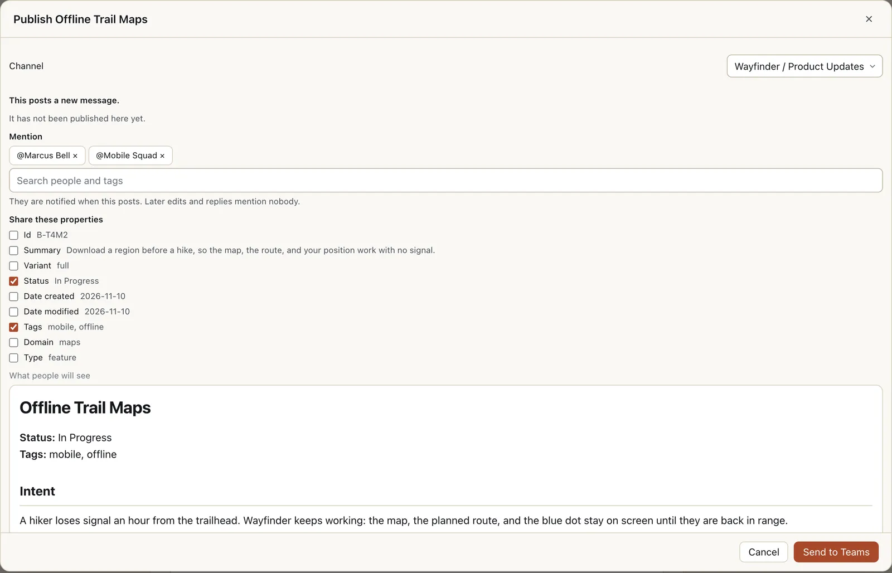
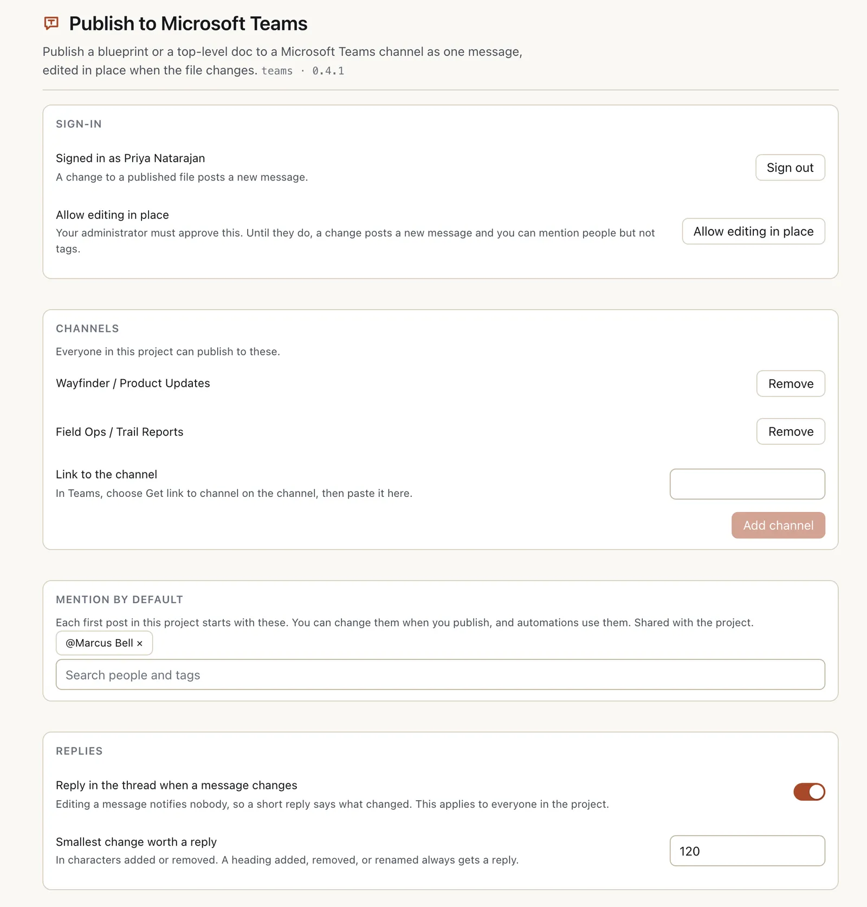
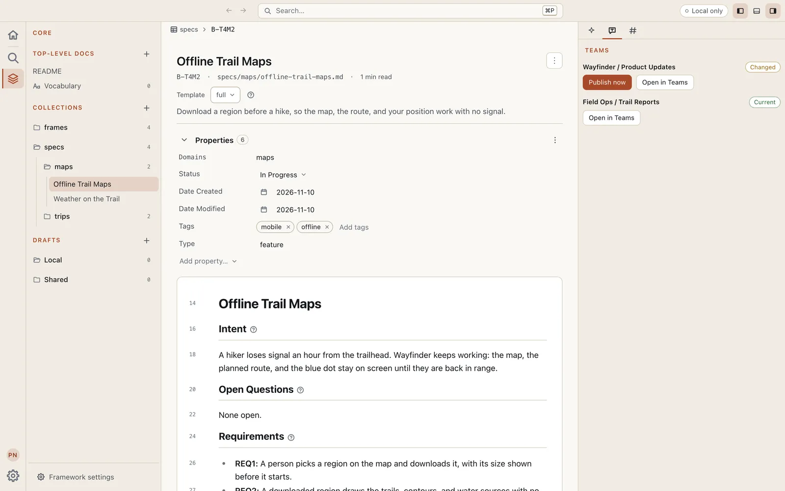
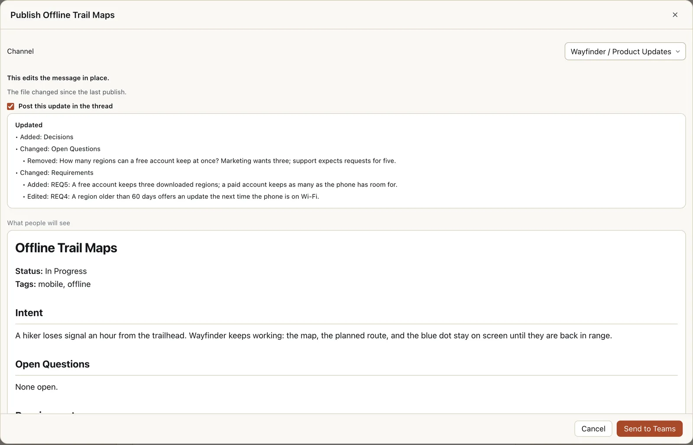

# Publish to Microsoft Teams

Send a blueprint or a top-level doc from [Eidos MD](https://eidosmd.com) to a Microsoft Teams channel as one message, and keep that message current. When the file changes, the next publish edits the message in place and replies in its thread with what changed. The channel holds one up-to-date message per file, not a scroll of stale copies.



Before anything leaves your machine you see exactly what goes out: the channel, who is mentioned, which properties come along, and a preview of the message.

- **One message per file.** The first publish posts it. Every publish after that edits the same message, so a link to it never goes stale.
- **Changes people actually notice.** Editing a message in Teams notifies nobody, so a big enough change gets a short reply in the thread listing the sections and list items added, removed, and changed.
- **The right people, tagged.** Mention people, tags, or the whole channel on the first post, and set who a project mentions by default.
- **Yours, and private.** It signs in as you, runs on your machine, and talks to Microsoft directly. Nothing is hosted, and nothing is sent unless you ask.

## Get started

### 1. Install it

In Eidos MD, open **Settings > Community plugins > Browse**, search for Teams, and open **Publish to Microsoft Teams**. Choose **Install**, then **Enable**. That installs it from the Registry, which checks every file against the checksum it lists, so install it there rather than from this repository.

### 2. Sign in to Microsoft

Open the plugin's settings: **Settings > Community plugins**, then **Publish to Microsoft Teams**. Under **Sign-in**, choose **Sign in to Teams**, then **Open Microsoft sign-in**, and finish in your browser with your work or school account. When you are done, the page reads **Signed in as** and your name.

Microsoft's consent screen names the app Eidos MD Publish for Teams, from The Virtual Panda LLC, a verified publisher. This first sign-in asks to post messages and replies in channels as you (`ChannelMessage.Send`), to find people to mention (`User.ReadBasic.All`), and to show which team a channel is in (`Team.ReadBasic.All`). Most organizations let a person agree to these on their own. If yours does not, the page says **Your organization has to approve this app** and gives you an address to send your administrator (see [For your Teams administrator](#for-your-teams-administrator)).

### 3. Add a channel

In Teams, choose **Get link to channel** on the channel. Back in Eidos MD, paste it into **Link to the channel** and choose **Add channel**. The channel is named for you, by its team and its name, such as Wayfinder / Product Updates. Everyone in the project can publish to the channels added here.



This person is signed in but editing has not been approved yet, so a change would post a new message and **Allow editing in place** is offered. Below the channels, **Mention by default** and **Replies** apply to everyone in the project.

### 4. Allow editing in place

Until editing is allowed, a change to a published file posts a new message and the old one stays in the channel. Choose **Allow editing in place** and sign in again in your browser. Editing (`ChannelMessage.ReadWrite`) and mentioning tags (`TeamworkTag.Read`) always take an administrator's approval, which Microsoft requires. Until it is given, you can still post, reply, and mention people. Once it is, the page reads "A change to a published file edits its message in place."

### For your Teams administrator

There is nothing to install in Teams: no bot, no Teams app, and no server. Each person signs in to a multi-tenant Microsoft Entra app, and the plugin acts as that person, with delegated permissions only.

- **App:** Eidos MD Publish for Teams, application (client) ID `e1c53a47-293c-422b-a75c-4aaddfe910c7`, verified publisher The Virtual Panda LLC.
- **Always asked:** `ChannelMessage.Send` (post and reply in channels), `User.ReadBasic.All` (find people to mention), `Team.ReadBasic.All` (show a channel's team name).
- **Asked for editing in place:** `ChannelMessage.ReadWrite` (edit the person's own messages) and `TeamworkTag.Read` (mention tags). Both need admin consent.

When a person's sign-in is refused, Eidos MD shows them an address to send you. It is Microsoft's admin consent page for exactly the permissions they asked for. Open it signed in as an administrator and accept, then have them sign in again. To approve editing in the same step, ask them to sign in with `eidos teams login --edit` from the terminal before sending you the address; once they are signed in, **Allow editing in place** asks for the same.

## Everyday use

### Publish a file

Open a blueprint or a top-level doc and look at the **Teams** tab in the right sidebar. It lists each channel with where this file stands there: **Not published**, **Current**, or **Changed**. **Publish now** opens the Publish dialog for that channel, and **Open in Teams** takes you to the message. **Publish…** in the command palette opens the same dialog.



In the dialog:

- **Channel** says where it goes.
- **Mention**, on a first post: search for people and tags, or the whole channel. They are notified when it posts, and the project's defaults are already filled in. Later edits and replies mention nobody.
- **Share these properties**, on a first post: tick the frontmatter worth showing at the top of the message, such as Status or Tags. The channel remembers your choice, and a shared property stays on the message's later edits.
- **What people will see** previews the message.

Choose **Send to Teams** to post it.

### When the file changes

The channel's row turns **Changed**. Publish again and the dialog says **This edits the message in place.** When the change is big enough, **Post this update in the thread** is ticked and shows the reply that goes with it. A smaller change leaves it unticked, and you can tick it when people should hear about it anyway. When nothing changed, the dialog says **Nothing to send.**



What counts as big enough is set under **Replies** in the plugin's settings: **Smallest change worth a reply**, 120 characters added or removed by default, and a heading added, removed, or renamed always counts. **Reply in the thread when a message changes** turns replies off for the whole project.

### Automations

The **Publish to Teams** step publishes the file that started a run, or one you name, to a channel, with the project's default mentions and the properties that channel last shared. The first run to reach it asks before it sends, since it leaves your machine. If someone else posted the message, the step stops, unless **If someone else posted the message** is set to **Post a second message**.

## Good to know

- **Messages are posted as you, and only their author can edit them.** When a teammate's file changes, they publish it again. If you publish a file someone else already posted to a channel, the dialog tells you who posted it and the button reads **Post a second message**: yours goes up under your name, and theirs stays. Asking the author to publish keeps it one message.
- **Until editing is approved, every change posts a new message.** The old one stays in the channel.
- **A message over 28,000 bytes is refused** before anything is sent.
- **The file is the source.** An edit made in Teams is overwritten by the next publish. A message deleted in Teams is replaced by a new one on the next publish.
- **Taking things away leaves the messages.** Removing a channel, or a file from the project, leaves its messages in Teams.
- **A tag stays in its team.** A team's tag is left out of a post to a channel in another team.
- **Team names arrived later.** If you signed in before team names were shown, the channels read as just their names; sign out and sign in again to see Engineering / General rather than General.

## Requirements

- Eidos MD 0.18.0 or later.
- A Microsoft 365 work or school account that can post in the channel.
- An administrator's approval for editing in place and for mentioning tags.

## Privacy

- The plugin runs on your machine and talks to Microsoft directly. Nothing is hosted, and nothing is sent unless you publish, or an automation you approved does.
- Your sign-in is kept in the Eidos app data folder, readable only by you. It is never written into the project.
- The project keeps its channels and a record of each publish in `.eidos/plugins/teams/`, shared with everyone in it: the message, who sent it and when, and a compressed copy of what was sent, so the next publish can say what changed.

## From the terminal

Everything above works from the `eidos` CLI too:

```bash
eidos plugin install @The-Virtual-Panda/teams
eidos plugin enable teams
eidos plugin allow teams
eidos teams login                     # --edit also asks for editing in place
eidos teams connect --channel "<link from Get link to channel>"
eidos teams publish B-X05 --to general --dry-run
eidos teams publish B-X05 --to general
```

`eidos teams login` opens Microsoft's sign-in in your browser. On a machine with no browser, `eidos teams login --device` signs in with a code you enter elsewhere, which security defaults and many organizations block. In a script, `--take-over` says yes to posting a second message. `eidos teams status` shows where each file stands. For every command and option, run `eidos instructions teams`.
